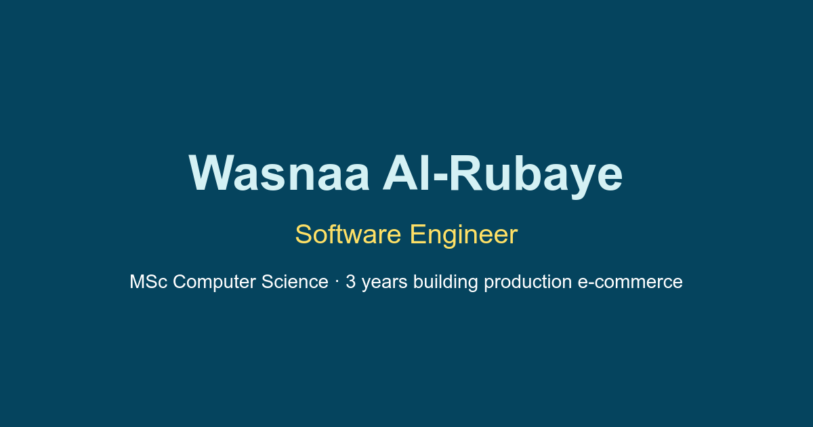

# Wasnaa Al-Rubaye – Portfolio

Personal portfolio of Wasnaa Al-Rubaye, a software engineer with 3 years building and optimising production e-commerce sites, now studying for an MSc in Computer Science at Birmingham City University.

**Live site:** https://wasnaaraafat.github.io/Portfolio/



## Tech stack

- React 18 + TypeScript
- Tailwind CSS
- Framer Motion for scroll animations
- react-scripts (Create React App) for the build
- Deployed to GitHub Pages with `gh-pages`

## Features

- Work projects presented as short case studies (problem, what I built, result) with tech-stack chips
- Experience timeline, grouped skills and education
- Responsive layout with a mobile menu
- Accessibility: keyboard-accessible tabs and menu, visible focus outlines, descriptive alt text and link labels, AAA colour contrast for text
- Content is visible by default; scroll animations only run when supported and when the visitor hasn't asked for reduced motion
- Performance: compressed WebP images sized for display, lazy loading below the fold, self-hosted font
- SEO and sharing: meta description, Open Graph / Twitter cards and a `<noscript>` fallback

## Running locally

Requires Node.js and npm.

```bash
npm install
npm start
```

Then open http://localhost:3000/Portfolio.

## Editing content

All text lives in two data files, so most updates don't need component changes:

| What | Where |
| --- | --- |
| Name, location, contact details, hero copy, experience, education, skills, nav links, CV filename | `src/data/content.ts` |
| Work, personal and early projects | `src/data/projects.ts` |
| CV PDF | `public/assets/cv/` (filename must match `cvFileName` in `content.ts`) |
| Project screenshots | `public/assets/images/projects/` (WebP, about 800px wide, 16:9) |
| Social sharing image | `public/og-image.png` (1200×630) |

## Build and deploy

```bash
npm run build    # production build in /build
npm run deploy   # builds, then publishes /build to the gh-pages branch
```

## Project structure

```
public/            static files: index.html, icons, images, CV, manifest
src/
  components/      page sections (Hero, Projects, Experience, Skills, ...) and Card
  data/            site content (content.ts, projects.ts)
  hooks/           useReveal: progressive-enhancement scroll animation
  types/           shared TypeScript types
  assets/fonts/    PT Sans
```

## Contact

- Email: wasnaa.alroubaie@gmail.com
- LinkedIn: https://www.linkedin.com/in/wasnaa/
- GitHub: https://github.com/WasnaaRaafat
